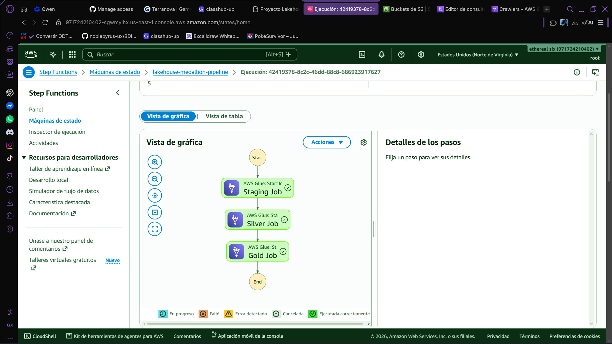
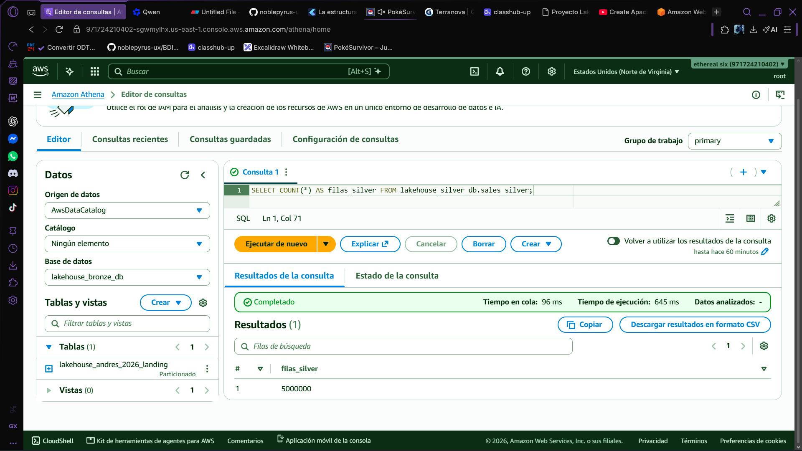
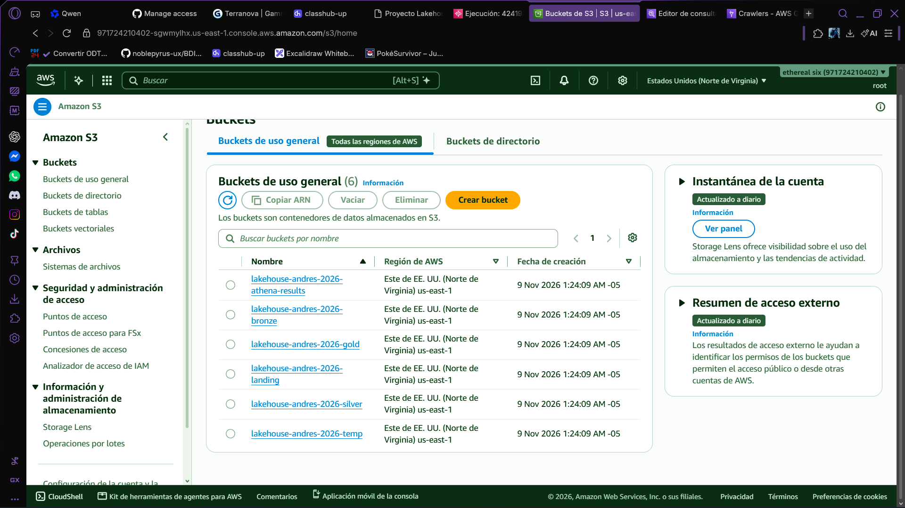

# Evidencias de Funcionamiento - Lakehouse Medallón

Este documento respalda el funcionamiento end-to-end del pipeline de datos.

##  Línea de Vida del Dato (Data Lifecycle)
1. **Generación**: `generar_datos.py` crea 5M de filas en CSV (ventas) y 500K en JSON (logs).
2. **Ingesta (Landing)**: Los archivos caen en `s3://...-landing/` (zona cruda e inmutable).
3. **Estandarización (Bronze)**: El *Staging Job* (Glue 5.0) convierte CSV a Parquet y registra el esquema explícito en el Glue Catalog.
4. **Limpieza (Silver)**: El *Silver Job* aplica reglas de negocio (deduplicación, tipado estricto, limpieza de texto) usando DataFrame API nativo de Spark.
5. **Modelado (Gold)**: El *Gold Job* construye el Modelo Estrella (1 Hecho + 5 Dimensiones) con métricas precalculadas (`revenue`) y almacenamiento columnar.
6. **Orquestación**: AWS Step Functions coordina el flujo `.sync` (espera activa), disparado por evento S3 (EventBridge).
7. **Consumo**: Amazon Athena consulta las tablas `gold_*` para dashboards de BI.
8. **Observabilidad**: Logs estructurados en CloudWatch y alertas de costo en AWS Budgets.

##  Pruebas Adjuntas
- **`01_pipeline_step_functions.png`**: Ejecución exitosa y secuencial del orquestador.

- **`02_consulta_athena_gold.png`**: Validación del modelo estrella con agregaciones en vivo.

- **`03_estructura_s3.png`**: Evidencia física de la separación de capas (Landing, Bronze, Silver, Gold).

##  Mejoras de Producción futuras (Feedback)
- Migración de `print` a `logging` estructurado para entornos serverless.
- Uso de Glue Version 5.0 y workers G.2X para mejor rendimiento.
- Nomenclatura diciente de tablas (`gold_fact_sales`, `silver_ventas_clean`).
- Esquema explícito en la creación de tablas para evitar "particiones fantasma" del Crawler.